  <a href="https://phoebefu6.github.io/"><b>Visit my site</b></a>
  &nbsp;·&nbsp;
  <a href="https://github.com/phoebefu6">Follow on GitHub</a>
  &nbsp;·&nbsp;
  <a href="https://www.linkedin.com/in/phoebe-fu-50168895/">LinkedIn</a>
  &nbsp;·&nbsp;
  <a href="https://phoebefu6.github.io/learn-with-phoebe/">Browse the courses</a>

<!-- STATS:START -->
**158 free courses** live right now, **1798 sessions** across **18 domains**, on **170 live sites**. All free, all in the browser.
<!-- STATS:END -->

---

### Start anywhere

| | What it is | Open it |
| --- | --- | --- |
| 📚 | **Courses** - free, hands-on, two tracks: decide or build | [learn-with-phoebe ↗](https://phoebefu6.github.io/learn-with-phoebe/) |
| 🔬 | **Skill teardowns** - field-tested by shipping with each one | [agent-skills-phoebe-picks ↗](https://phoebefu6.github.io/agent-skills-phoebe-picks/) |
| 🧰 | **Data skills** - installable, real runs on real rows | [phoebe-data-skills ↗](https://phoebefu6.github.io/phoebe-data-skills/) |
| 🚢 | **Build log** - what I ship | [phoebe-the-builder ↗](https://phoebefu6.github.io/phoebe-the-builder/) |
| 🎨 | **Explainers** - data and AI, in pictures | [sketch-ideas-with-phoebe ↗](https://phoebefu6.github.io/sketch-ideas-with-phoebe/) |

---

<!-- HIGHLIGHTS:START -->
**📘 Today from the shelf** · [Reading the Yellow Emperor](https://phoebefu6.github.io/learn-tcm-with-phoebe/)
A guided first read of 黄帝内经 - yin-yang, five phases, the zang-fu body...
<!-- HIGHLIGHTS:END -->

---

<picture>
  <source media="(prefers-color-scheme: dark)"
          srcset="https://raw.githubusercontent.com/phoebefu6/phoebefu6/output/snake-dark.svg">
  <source media="(prefers-color-scheme: light)"
          srcset="https://raw.githubusercontent.com/phoebefu6/phoebefu6/output/snake-light.svg">
  
</picture>

